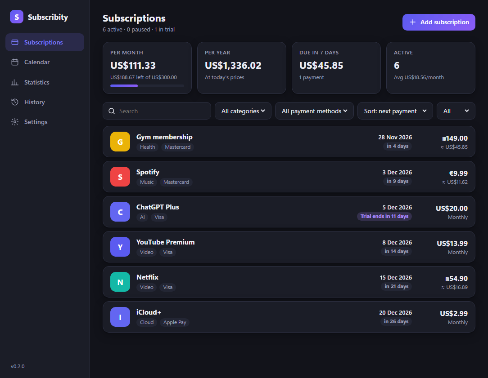

# Subscribity

**Know what your subscriptions cost, and never get surprised by a renewal again.**

[**Download for Windows**](https://github.com/13barash/subscribity/releases/latest) · [Buy me a coffee ☕](https://buymeacoffee.com/13barash)

Subscribity is a small, free app for Windows that keeps track of everything you pay for
regularly: streaming, music, cloud storage, phone plans, gym, software, anything. It sits
quietly next to the clock, tells you what you spend each month and each year, and warns you
a few days before something renews, so you have time to cancel what you no longer use.

## What it does for you

- **See your real total.** Monthly and yearly cost of all your subscriptions in one place,
  even when they are in different currencies (they are converted to your own currency).
- **Get reminded before you pay.** A Windows notification a few days before each renewal.
  You choose how many days, per subscription.
- **Catch free trials before they turn into charges.** Mark a subscription as a free trial
  and Subscribity reminds you before the trial ends.
- **Stay on budget.** Set a monthly budget, watch the meter fill up, and get a warning if you
  go over it.
- **Know what you paid.** A payment history is kept automatically every time a subscription
  renews, and price changes are remembered, so you can see when something got more expensive.
- **Upcoming payments at a glance.** Click the tray icon for a quick look at what is due next,
  or open the full window for the calendar, statistics and settings.
- **Add things fast.** Ready-made templates for popular services, or type your own.
- **Bring your list with you.** Import from a CSV or JSON file (for example an export from
  another subscription tracker) and export your list to CSV at any time.
- **Your data is safe.** Automatic weekly backups (the last 30 days are kept) that you can
  restore with one click.
- **Updates itself.** When a new version comes out, Subscribity offers to install it for you.

## Download and install

1. Go to the [latest release](https://github.com/13barash/subscribity/releases/latest) and
   download **`Subscribity.exe`**.
2. Make a new folder for it, for example `Documents\Subscribity`, and move the file there.
   Your subscriptions are saved in this same folder.
3. Double-click `Subscribity.exe`. The window opens so you can add your first subscriptions.

That's it. Subscribity adds itself to the Start menu and starts with Windows (you can turn
that off in Settings). From now on, click its icon next to the clock to open it.

**Can't see the icon?** Windows sometimes hides new tray icons. Click the small **^** arrow
next to the clock, then drag the Subscribity icon onto the taskbar to keep it visible.

### "Windows protected your PC"

Subscribity is a new app from an independent developer, so Windows SmartScreen may show this
warning the first time. Click **More info**, then **Run anyway**. This happens only once.

### Requirements

Windows 10 or Windows 11. On Windows 10, the free Microsoft Edge WebView2 Runtime is needed
(most PCs already have it; if the window doesn't open, install it from
[Microsoft](https://developer.microsoft.com/microsoft-edge/webview2/)).

## Light on your PC

Subscribity is built to stay out of your way:

| | Memory used |
|---|---|
| Waiting in the tray | about 2 MB |
| While the window is open | about 70–90 MB, all given back when you close it |

The whole app is a single file under 1 MB. No installer, no background services.

## Updating

Subscribity checks for a new version once a week (you can change this to monthly or off in
**Settings → Updates**). When one is available you get a notification; click **Update now**
and the app updates and restarts by itself. Your subscriptions and settings are kept.

## Backups and moving to a new PC

- Backups are made automatically every week and kept for 30 days. Restore one from
  **Settings → Backups**.
- To move to another PC, copy the whole Subscribity folder and run `Subscribity.exe` from its
  new place.

## Uninstalling

Open **Settings → Uninstall** in the app, or go to Windows **Settings → Apps → Installed apps**,
find Subscribity and choose **Uninstall**. You'll be asked whether to keep your data or delete it.

## Privacy

No account, no sign-up, no ads, no tracking. Your list never leaves your computer.
The app only goes online to:

- get today's exchange rates (only if you use more than one currency),
- show the logo of a service (only if you entered its website),
- check for updates.

## Support Subscribity

Subscribity is free and always will be. If it helps you save money and you'd like to say thanks,
you can [buy me a coffee](https://buymeacoffee.com/13barash). It's completely optional.

## Questions or problems?

Open an issue on the [Issues page](https://github.com/13barash/subscribity/issues) and
describe what happened.

## License

Free and open source under the MIT license. See [LICENSE](LICENSE).
